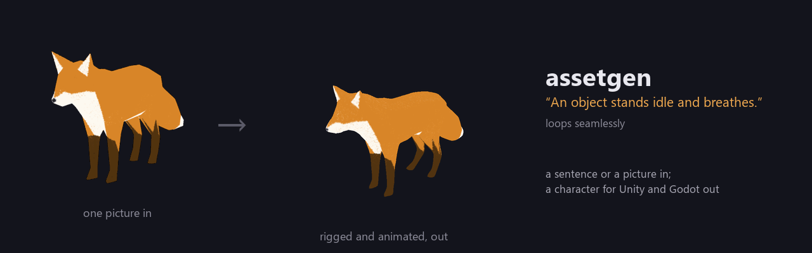
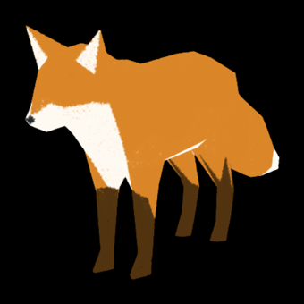
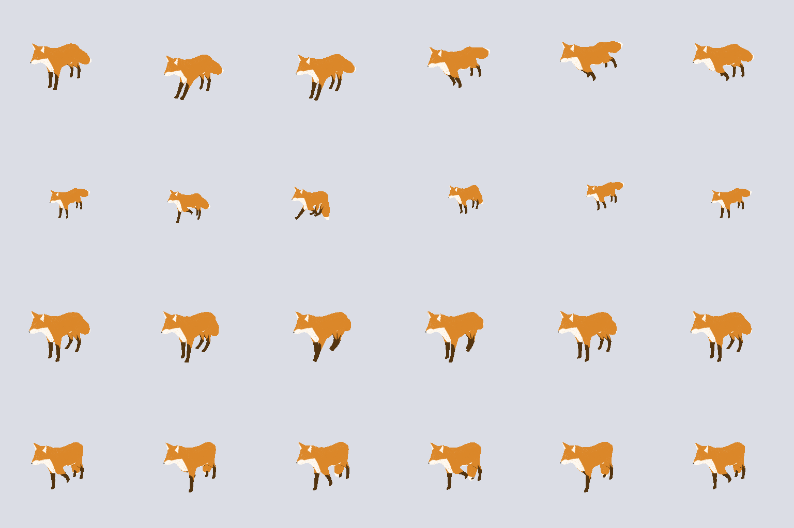

<!-- Header: docs/header.gif. scripts/make_header.py renders it from a finished run; scripts/compose_header.py webui.mp4 unity.mp4 makes it from screen recordings of the web UI and Unity, side by side. -->
<!--<p align="center"></p>-->

<h1 align="center">assetgen</h1>

<p align="center"><b>Type a sentence. Get a rigged, animated character, a prop or a whole scene in your game engine.</b></p>

<p align="center">
  Text or a picture → textured mesh → skeleton → motion clips → a prefab in Unity or a scene in Godot.<br>
  Open models, one GPU, no artist in the loop. <i>Experimental.</i>
</p>

<p align="center">
  <a href="#quick-start">Quick start</a> ·
  <a href="#text-to-image-bring-your-own-generator">Text to image</a> ·
  <a href="#motion-from-video">Motion from video</a> ·
  <a href="#props-and-dioramas">Props</a> ·
  <a href="#scenes">Scenes</a> ·
  <a href="#the-server">Server &amp; API</a> ·
  <a href="#unity">Unity</a> ·
  <a href="#godot">Godot</a> ·
  <a href="#for-llm-agents-and-scripts">Agents</a> ·
  <a href="#how-it-works-and-why">How it works</a>
</p>

---

Stable Diffusion made "describe it and see it" normal for pictures. assetgen tries the same for the thing a game
actually needs: a character that stands on the ground, faces forward, has bones, and walks, runs, idles and attacks
in loops that never pop.

It's a tight chain of open research models (Idol, SkinTokens and UniMate) plus whichever image generator you already
run, wrapped so the result drops into an engine and *works*. The right clips loop, a locomotion blend tree runs at
the speeds the clips were generated at, and there's a prefab you can drag into a scene.

```
"a goblin shaman with a lantern and a hooded cloak"
        │
        ├── image        stable-diffusion.cpp, A1111, ComfyUI, OpenAI-compatible, or your own picture
        ├── splat        Idol: one image to a 3D Gaussian splat
        ├── mesh         upright, front-facing, textured, 40k faces
        ├── rig          SkinTokens: a skeleton for any body (bipeds, quadrupeds, tails, wings)
        ├── motion       UniMate: one clip per sentence ("An object walks forward."), loops that close seamlessly
        └── finalize     goblin.glb  +  goblin.assetgen  →  Unity prefab · Godot scene · any glTF engine
```

<table>
  <tr>
    <td width="24%" align="center"><br><sub>one picture in</sub></td>
    <td align="center"><br>
      <sub>out: a rigged fox and four clips from four sentences. Top to bottom: <i>jumps in place</i> (once),
      <i>runs forward</i>, <i>stands idle and breathes</i>, <i>walks forward</i>. 0.6 m tall; Unity and Godot blend
      idle → walk → run at 0, 0.22 and 0.47 m/s.</sub></td>
  </tr>
</table>

## What you get

- **A character from a sentence or a picture.** Text goes through your image generator first; a picture skips that.
- **Any anatomy.** The rig isn't a humanoid template: horns, tails, four legs and an axe all get bones.
- **Motion from text, one clip per line.** `An object roars. [once]`. Loops close to within a millionth of the
  character's size, at any length.
- **Or motion from video.** Tag a prompt `[video]` and a video model (MiniMax-H3 through stable-diffusion.cpp)
  animates a picture of the character, and its rig is fitted to that video. The clip comes with its footsteps,
  the moment a one-shot lands, and the sound the video model made with it; see [Motion from video](#motion-from-video).
- **One `.glb` with every clip**, Y-up, facing +Z, feet on the ground, at the height you asked for.
- **A character file** (`.assetgen`) that tells engines what each clip is for, whether it loops and how fast it
  travels, so they can wire it up without guessing.
- **Unity:** a package that turns that into an Animator Controller with a speed-driven locomotion blend tree and a
  prefab, a generator window in the Editor, and `unity command assetgen ...` for the new Unity CLI and its MCP mode.
- **Godot:** an addon that imports the same character ready to play, with an AnimationTree.
- **Props and set pieces too.** `--kind prop` makes one static object (a barrel, a tree, a lamp post), `--kind diorama`
  a whole set piece as one model. Both stop after the mesh and come with a collider and a footprint; see
  [Props and dioramas](#props-and-dioramas).
- **Whole scenes.** A spec of what is where (or a sentence for a language model to plan, or a concept picture to take
  apart) becomes generated objects in a shared style on generated ground, laid out without overlaps, in one instanced
  glTF; see [Scenes](#scenes).
- **A server** with a web UI and an HTTP API on one port, so you, a script or an LLM agent can drive all of it.

## Quick start

On Linux with an AMD GPU (ROCm). CUDA and CPU work too; see [Setup](#setup).

```bash
bash scripts/setup_rocm.sh          # environment, model checkouts and weights (~4 GB), then a self-check
uv run python server.py             # web UI on http://127.0.0.1:7860, API on /api/v1, reference on /docs
```

Open the web UI, type a description, press **Generate character**. Every stage's result appears as it finishes, and
the character ends up in an interactive viewer with a clip picker, plus downloads for Unity and Godot.

To make characters from text you need an image generator running. With
[stable-diffusion.cpp](https://github.com/leejet/stable-diffusion.cpp)'s server, for example:

```bash
sd-server -m <your model> --listen-port 1234 &
uv run python server.py --image-backend sdcpp --image-url http://127.0.0.1:1234
```

Or from the command line, with no server:

```bash
uv run assetgen run --text "a goblin shaman with a lantern" --out outputs/goblin --height 1.2 \
    --prompt "An object stands idle and breathes." "An object walks forward." "An object casts a spell. [once]"
uv run assetgen export outputs/goblin --engine unity --project ~/MyGame
```

## Text to image: bring your own generator

The 3D stages want one picture of one thing, whole, on a plain background. assetgen frames your description that
way for the kind of asset (`"<your text>, full body character, standing in a relaxed A-pose, ... plain white
background"` for a character, `"<your text>, a single game prop, ..."` for a prop; `--raw-prompt` turns it off) and
asks whichever backend you point it at:

| Backend | Talks to | Default address |
|---|---|---|
| `sdcpp` | stable-diffusion.cpp's `sd-server`, loading its model for each picture and unloading it after | `http://127.0.0.1:1234` |
| `a1111` | AUTOMATIC1111, Forge, SD.Next (same API) | `http://127.0.0.1:7860` |
| `openai` | Any OpenAI-compatible `/v1/images/generations`: OpenAI, LocalAI, sd-server | `https://api.openai.com/v1` |
| `comfyui` | Your ComfyUI workflow (API format, with `{{prompt}}`, `{{seed}}`, ... placeholders) | `http://127.0.0.1:8188` |
| `command` | Any program: `--image-command "sd-cli -m model.gguf -p {prompt} -o {out} -s {seed}"` | |

Set them per run (`--image-backend`, `--image-url`, `--image-model`, `--image-size 832x1216`, `--image-steps`), per
server, or with `ASSETGEN_IMAGE_BACKEND`, `ASSETGEN_IMAGE_URL` and `ASSETGEN_IMAGE_MODEL`. Keys come from
`ASSETGEN_IMAGE_API_KEY` (or `OPENAI_API_KEY`) and are never written to run folders. In the web UI, **Preview images**
shows a few candidates so you can pick the one to build before the 3D stages spend their minutes. To add a backend, see
`assetgen.imagegen.register`.

With `sdcpp`, assetgen manages sd-server's model itself, so there's nothing to load by hand. Start sd-server with
`--model-dir` and it can be empty. For each picture assetgen loads the model, generates, and unloads it again, because
sd-server otherwise keeps its peak VRAM and leaves the 3D stages short (sd.cpp loads quickly). Which model:

- the one you pick: the **Model** list in the web UI and Unity, or `--image-model`;
- otherwise, whatever sd-server has loaded, or the model assetgen loaded last on that server;
- otherwise, the model in sd-server's folders that clearly fits a text-to-image recipe. assetgen matches files to
  sd.cpp's recipes by name (`sdxl…` → SDXL, `flux1-schnell…` → FLUX.1 schnell with its text encoders and VAE).

When several models fit and none is clearly the one, assetgen says so and lists them. `--image-model` takes an entry
from that list (`sdxl-checkpoint:checkpoints/my-model.safetensors`), a recipe (`flux1-schnell`) or a file name. A model
given to sd-server with `-m` can't be loaded back through its API, so that one stays loaded. `--image-keep-loaded`
(or `ASSETGEN_IMAGE_KEEP_LOADED=1`) leaves the model loaded.

**Redrawing a picture.** Every backend can also start from a picture (image to image): a rough crop, a sketch, or an
earlier result to restyle. `--strength` runs from 0 (keep it) to 1 (ignore it), and an optional mask (white where it
may change) limits where it changes. The picture is fitted onto the canvas, and transparent parts become the
background:

```bash
uv run assetgen image --kind prop --prompt "a mossy wooden barrel" --init barrel.png --strength 0.5 --out drafts/barrel
```

`sdcpp` and `a1111` use `/sdapi/v1/img2img`, `openai` uses `/v1/images/edits`, `comfyui` needs a workflow with
`{{image}}` and `{{denoise}}` (`--comfy-edit-workflow`), and `command` needs a template with `{init}` and `{strength}`
(`--image-edit-command`).

## Motion from video

UniMate knows a fixed vocabulary of motions, and outside it its clips get weak. Video models have seen far more
motion. A prompt ending in `[video]` makes its clip from one:

```bash
uv run assetgen run --image fox.png --out outputs/fox --height 0.6 \
    --prompt "An object stands idle and breathes." "An object pounces on something. [once] [video]" \
    --video-url http://127.0.0.1:1234
```

1. **Start frame.** The rigged character is rendered at rest, from a three-quarter view a little above
   (`capture/start.png`), framed so its silhouette spans 60% of the picture: the tracker and the video model
   work with the pixels it covers, and room is left for it to move. Every pixel of it is a known point on the
   mesh.
2. **Video.** sd-server makes a video with MiniMax-H3's first/last-frame model (recipe `minimax-h3-fl2va`),
   starting and ending on that frame, at 24 fps: 4.5 s for a loop, 2.3 s for a one-shot. Ending on the start
   frame brings one-shots back to their stance, and lets loops be cut from the middle. assetgen loads and
   unloads the model around it, as it does for pictures. With `--video-backend command --video-command "..."`
   any program makes it instead (sd-cli with the options your machine needs, for instance), and
   `assetgen capture start` writes the start frame for a video made by hand.
3. **Tracks.** Points spread over the start frame are followed through the video with CoTracker3. Since each
   began on a known point of the mesh, each track says where that point went. A point inside a patch of flat
   colour can drift across it without the picture changing, so each is trusted by how much texture surrounds it
   (Shi and Tomasi's corner measure).
4. **Fit.** Joint rotations (and the hips' path) are fitted so those points land on their tracks. Nothing
   here knows about anatomy, so any rig works. One camera cannot see depth, so the fit also uses:
   - **the ground:** nothing sinks into it, and what rests on it does not slide. A foot on the ground has only
     one place along its pixel's ray. The slide penalty is robust: where the tracks plainly show a foot
     sliding, they win.
   - **travel:** resting points may move together by one shared velocity a frame. A camera that follows the
     character shows its planted feet sliding back, and that velocity is its ground speed.
   - **lost tracks:** a skeleton moves rigidly, so after a first fit a point the tracker lost lands far from
     its track; those observations are dropped and the clip fitted again.
   - **depth, optionally:** `--video-depth` adds Depth Anything V2 Small's relative depth of each frame, up to
     a scale and offset per frame. In both cases measured it made the fit worse (exact tracks on the Khronos
     walk 1.5% to 2.5%; CoTracker on the generated fox walking across the frame 5.1% to 7.0%), so it is off.
5. **Timing.** A loop is the stretch of the clip that best repeats itself, closed so its ends meet. A clip's
   **contacts** (part of the body coming to rest on the ground, by the bone that carries it) become footstep
   events. A one-shot's **phases** (wind-up, active, recovery) come from how fast its fastest parts move, and
   its **impact** is the strongest sound onset inside the active phase, since H3 makes a soundtrack with the
   picture. The sound goes with the clip.

The clip is written onto the same asset as UniMate's clips, so finalize merges them all, and the character
file says which clip came from where. Its events, phases and sound go into the character file, like this (the
numbers are illustrative):

```jsonc
{"name": "pounces_on_something", "role": "action", "source": "video", "fps": 24, "duration": 2.29,
 "phases": {"windup": [0, 0.54], "active": [0.54, 0.92], "recovery": [0.92, 2.29], "impact": 0.83},
 "events": [{"time": 0.83, "type": "impact"}, {"time": 1.21, "type": "contact", "joint": "bone_7"}],
 "sound": "sounds/pounces_on_something.wav"}
```

Godot emits them as `footstep(joint)`, `impact(clip)` and `clip_event(...)` signals and plays the sound from a
`Sound` player; Unity raises `Footstep`, `Impact` and `ClipEvent` from animation events and plays it from an
AudioSource. Both have `phase_of`/`PhaseOf` for a one-shot's phase at a time, which is where hit boxes and
damage go.

**How well it works.** `assetgen capture bench` plays a known animation from the rest pose (as a video
would), renders it lit at 512 px, tracks it, fits it and compares the result with the truth in 3D: the mean
distance of every vertex from where it should be, as a share of the asset's size. "Standing still" is the
same measure for not moving at all. Exact tracks isolate the fit; CoTracker3 on the rendered video is the
whole method short of the video model.

| Clip | Exact tracks | CoTracker3 | Standing still | Ground speed: exact, CoTracker (truth) |
|---|---|---|---|---|
| Khronos Fox walk | 0.7% | 3.7% | 4.9% | 103, 57 /s (101) |
| Khronos Fox survey (looking around) | 0.1% | 1.2% | 2.3% | |
| Khronos Fox run | 2.6% | 5.4% | 8.7% | 130, 65 /s (179) |
| assetgen's fox, UniMate's walk, camera following | | 1.2% | 2.2% | |

What the tracker costs depends on the texture. The Khronos Fox is painted in large flat colours, where tracked
points drift; on the texture assetgen bakes for its own fox, the tracked fit is within 1.2 to 1.6%. Speed is
where tracking costs most: it comes back at 36 to 56% of the truth, most likely because tracked feet drift a
little and the fit reads that as sliding. A run, with both feet often off the ground, has the least to pin its
depth. Not measured: the video model's own errors; MiniMax-H3 needs a bigger GPU than the 4 GB this was
measured on.

The motion stage's own path (`capture`, as a `[video]` prompt runs it) was run the same way, on the generated
fox: its start frame, a 108-frame video of its UniMate walk made from it with a following camera and an ease
back to the start frame, and CoTracker on all of it. It kept 91% of the tracked points, cut an 80-frame loop
with four footsteps and wrote the clip; the fit is 1.6% from the truth, against 2.1% for standing still.

## Props and dioramas

Not everything in a game moves. `--kind prop` makes one static object and `--kind diorama` a whole set piece (a ruined
watchtower on its rock, a market stall with its awning and crates) as one model. Both use the same image, splat and
mesh stages as a character, with framing for their kind, and then skip the rig and motion stages:

```bash
uv run assetgen run --kind prop --text "a wooden barrel with iron bands" --height 1.0 --out outputs/barrel
uv run assetgen run --kind prop --image lamp_post.png --height 3.2 --out outputs/lamp_post
uv run assetgen run --kind diorama --text "a ruined stone watchtower on a rocky outcrop" --height 6 --out outputs/tower
uv run assetgen batch --kind prop --texts props.txt --out outputs/props        # an asset library, one prop per line
```

Finalize scales the mesh to `--height` (1 m if not given) and puts its pivot at the centre of its base, on y = 0, so it
stands where you place it. It writes `<name>.glb`, a four-sided preview `<name>.png`, and the prop file
`<name>.assetgen` ([schema](schema/prop.schema.json)):

```jsonc
{
  "format": "assetgen.prop", "version": 1, "name": "pine", "kind": "prop",
  "model": {"file": "pine.glb", "units": "meters", "up": "+Y", "forward": "+Z", "pivot": "base",
            "height": 8.0, "size": [4.0, 8.0, 3.2], "...": "..."},
  "collider": {"type": "convex", "box": {"center": [0, 4, 0], "size": [4.0, 8.0, 3.2]}},
  "footprint": {"outline": [[-2.0, -1.6], "..."], "radius": 2.56, "base_radius": 0.28}
}
```

The collider is a convex hull for props and the mesh itself for dioramas, which you walk on (`--collider` picks
`convex`, `mesh`, `box` or `none`). Engines build it on import: Unity gives the prefab a MeshCollider or BoxCollider,
and Godot gives the scene a StaticBody3D with the matching shape. The footprint is the asset seen from above: its
outline, how far it reaches from its pivot, and how far its base does (a tree's trunk, not its canopy). Layouts use it to
space assets so they don't overlap.

## Scenes

A scene is an environment made of generated objects: a forest camp, a market square, a ruined courtyard. You say what is
in it and where; assetgen makes each kind of object once, as a prop, and places it as often as the scene needs on
generated ground:

```bash
uv run assetgen scene example --out camp.json      # a spec to start from
uv run assetgen scene plan --text "a forest camp at dusk with a tent, a campfire and logs to sit on" \
    --llm-base-url http://127.0.0.1:8080/v1 --out camp.json       # or have a language model write it
uv run assetgen scene build camp.json --out outputs/camp --devices cuda:0,cuda:1
uv run assetgen export outputs/camp --engine godot --project ~/my_godot_game
```

The spec ([schema](schema/scene-spec.schema.json)) is short:

```jsonc
{
  "name": "forest_camp",
  "style": "stylised low-poly, hand-painted textures, warm evening light",
  "ground": {"size": [24, 24], "prompt": "mossy forest floor with pine needles", "relief": 0.6},
  "objects": [
    {"id": "campfire", "prompt": "a ring of stones around burning logs", "height": 0.5, "place": [[0, 0]]},
    {"id": "tent", "prompt": "a canvas tent with wooden poles", "height": 2.2,
     "place": [{"position": [3.5, -2], "yaw": {"face": "campfire"}}]},
    {"id": "pine", "prompt": "a tall pine tree", "height": 9,
     "scatter": {"count": 16, "region": "edge", "scale": [0.8, 1.25]}},
    {"id": "boulder", "prompt": "a mossy granite boulder", "height": 1.0,
     "scatter": {"count": 8, "scale": [0.5, 1.4], "tilt": true}}
  ]
}
```

What the build does with it:

- **Objects.** Each one is a prop run of its own under `props/<id>/`. It can come from a `prompt`, an `image` (with
  `"redraw": 0.5`, the picture is first redrawn in the scene's style), a splat (`ply`) or a finished asset (`asset`: a
  run folder or `.glb`, so a library of props can be reused). Runs are resumable: change one prompt and only that
  object is made again; move things around and only the layout is redone. With several `--devices`, objects are made
  side by side.
- **Consistency.** The scene's `style` is added to every prompt. Then `harmonize` (0 to 1, default 0.5) evens out what
  separately drawn pictures still disagree on. It measures each object's colours over its surface and moves its
  brightness, contrast, saturation and white balance towards the others (or towards a `concept` picture). Hue is kept:
  a red barrel stays red, it just stops looking lit by a different sun. The white balance is read off near-grey
  surfaces, which show the colour of the light.
- **Ground.** A `prompt` is drawn as a texture and made tileable, by blending it with itself shifted half a tile, so it
  repeats every `tile` metres without seams. `texture` takes a picture instead, which suits small image models better:
  top-down ground textures need a capable one (SDXL, FLUX), and SD 1.5 tends to draw a landscape or cloth instead.
  `relief` and `feature` give it rolling hills.
- **Layout.**
  - `place` puts objects at chosen spots. `yaw` is degrees, `"random"`, or `{"face": "<id>"}` to turn the object's
    front towards another. The ground is levelled under each placed object so it sits flat.
  - `scatter` fills a region (`all`, `edge`, `centre` or a rectangle) with `count` copies at random sizes and turns.
    Each copy keeps clear of placed objects by their reach plus `clearance`, and of other scattered copies by their
    footprints, so trunks never cross and paths around the tent stay open.
  - Everything stands on the lowest ground under its base, so nothing floats on a slope. `tilt` leans rocks and logs
    with the slope instead.
- **Output.**
  - `<name>.glb`: the ground and every placed object. Each object's mesh is stored once and every placement is a node
    pointing at it, so forty pines cost one pine.
  - `<name>.assetgen`: the scene file ([schema](schema/scene.schema.json)), listing the objects and every placement.
  - `assets/<id>.glb`: each object as a prop of its own.
  - `<name>.png`: a preview from three quarters and from above.

Engines import the scene as one model. Godot gives the ground a trimesh body and every placed object a body with its
collider; Unity builds a static prefab with the same colliders. The objects under `assets/` import as ordinary props
too.

### From a picture of the whole scene

Props drawn one by one share a style prompt but not a picture. A concept picture of the whole scene, whether drawn,
generated or photographed, already has one look and one arrangement. `assetgen scene decompose` takes it apart into a
spec:

```bash
uv run assetgen scene decompose farm.png --objects "red barn, haystack, wooden cart" --known "red barn=6" --out farm.json
uv run assetgen scene decompose --text "a small farmyard with a red barn, haystacks and a cart" \
    --objects "red barn, haystack, wooden cart" --out farm.json          # draw the picture first
uv run assetgen scene build farm.json
```

1. **Find.** Grounding DINO finds every object named (open vocabulary), and SAM cuts each out from its box.
2. **Measure.** Depth Anything V2 (metric; `--setting indoor` for rooms) gives depth, and the picture is lifted into 3D
   with `--fov` (default 55 degrees). The ground plane is fitted to everything that is not an object (RANSAC).
3. **Place.** Each object is stood on that plane where its base meets it, with its height read off the plane.
   `--known` corrects the depth's scale from objects whose size you know.
4. **Turn.** An object's turn is recorded as the direction the picture saw it from (`{"seen_from": degrees}`). Once
   the object is made, the mesh stage knows where Idol's camera stood relative to the object's front, and layout turns
   it so the scene's camera sees the side the picture showed. This was checked end to end with the real mesh stage:
   a fox placed at a known turn came back matching its true shape to within 2 to 4% of its height, including when the
   picture showed its back.
5. **Ground.** The picture's own ground is seen from straight above: resampled onto the scene's ground plane, objects
   taken out and filled from around them. The paths and patches lie where the picture has them, under the objects
   that stood on them.

Objects with the same label share one prop, made from the clearest cut-out: the largest, least hidden by others or the
picture's edge. `--each` makes every one its own. Cut-outs go straight to Idol with their transparency. `--redraw 0.4`
redraws each one in the scene's style first, which completes parts that other objects hid. `<out>_found.png` shows
what was found, every object's base and height, and a 1 m grid on the ground plane, so you can check the
reading before spending GPU time on the objects. The models (about 1.2 GB, Apache-2.0) download on first use.

**Which approach for which job:**

- A *diorama* (`--kind diorama`) is the quickest way to a static set piece that nothing needs to move or come apart:
  one picture, one model.
- A *scene* is for anything bigger or more alive. The objects are separate, so they can have colliders, be moved, be
  reused in another scene and be instanced cheaply.
- *Decomposing a concept picture* gives a scene the picture's coherence and arrangement. Planning or writing a spec
  gives you control over every object.

These mix: a diorama can be one object in a scene (`"kind": "diorama"`), and a decomposed spec is an ordinary spec,
to edit, add scatter to, or rebuild.

## The server

`python server.py` (same as `assetgen serve`) runs the web UI and the API on one port and one job queue: a job
started from the browser shows up in the API and in Unity's window, and the other way round. Each job is a run folder
under `outputs/webui/`, laid out like `assetgen run`, so jobs survive restarts and the CLI can resume them. With
several GPUs (`--devices cuda:0,cuda:1`), jobs run side by side, one per GPU.

```bash
curl -s localhost:7860/api/v1/jobs -H 'Content-Type: application/json' -d '{
  "prompt": "a clockwork owl with brass wings",
  "motions": ["An object stands idle.", "An object flaps its wings and flies forward.", "An object screeches. [once]"],
  "height": 0.6
}'
# {"id": "20261118-181502-a_clockwork_owl_with_brass_wings", "status": "queued", "stages": {...}, "urls": {...}}

curl -N localhost:7860/api/v1/jobs/<id>/events                    # live log and progress (server-sent events)
curl -o owl-unity.zip localhost:7860/api/v1/jobs/<id>/export/unity
```

| Endpoint | |
|---|---|
| `POST /api/v1/jobs` | An asset from `prompt`, `image` (base64), `upload`, or `draft` (a candidate picked from `/images`); `kind`: `character` (default), `prop` or `diorama` |
| `GET /api/v1/jobs`, `GET /api/v1/jobs/{id}` | Status, stage, progress, preview URLs; the character file once done |
| `GET /api/v1/jobs/{id}/events` | Server-sent events: log lines and status until the job ends |
| `POST /api/v1/jobs/{id}/continue` | Redo from `mesh`, `rig`, `animate` or `finalize` (new motions on the same rig, say) in a new job |
| `POST /api/v1/jobs/{id}/cancel` | Stops the stage and everything it started |
| `GET /api/v1/jobs/{id}/export/{unity,godot,gltf}` | A zip ready for the engine |
| `POST /api/v1/images` | Candidate pictures for a prompt (framed for its `kind`), to choose from |
| `POST /api/v1/uploads` | An image or a `.ply` splat, for `POST /jobs` |
| `GET /api/v1/info` | Version, devices, image backend health, default motions |
| `POST /api/v1/scenes` | A scene from a `spec`, or a `prompt` for the language model to plan; `from` reuses an earlier scene's objects |
| `POST /api/v1/scenes/plan`, `GET /api/v1/scenes/example` | A spec from a description; an example spec |
| `POST /api/v1/scenes/decompose` | A spec from a picture of the whole scene (`image`, `upload` or a `prompt` to draw it) and the `objects` to look for; its files are `draft:<id>/...`, which `POST /scenes` takes |

`/docs` has the full reference. Planning scenes from a description needs a language model: start the server with
`--llm-base-url` (any OpenAI-compatible endpoint; or `ASSETGEN_LLM_URL`, `ASSETGEN_LLM_MODEL`), or send `llm` with the
request. To listen beyond localhost, set a token (`--token` or `ASSETGEN_API_TOKEN`) and send
`Authorization: Bearer <token>`.

## Unity

The [Unity package](unity/com.assetgen.unity) (Unity 6) installs from git:

```
https://github.com/adbedford-swe/asset-generation.git?path=/unity/com.assetgen.unity
```

or `assetgen export <run> --engine unity --project <project>` copies the character in and adds the package for you.

Drop `goblin.glb` and `goblin.assetgen` into `Assets/` and the package builds `goblin.controller` and
`goblin.prefab`. The controller has a **Locomotion** state that blends idle, walk and run on a `Speed` parameter in
metres per second, at the speeds the clips were generated at. Every clip also gets its own state, and one-shots fade
back to Locomotion when they finish. Clips play in place, so your controller moves the character and the Animator
never fights it:

```csharp
var goblin = GetComponent<AssetgenCharacter>();
goblin.Speed = goblin.WalkSpeed;          // walks, feet planted
goblin.Play("casts_a_spell");             // a one-shot; returns to Locomotion by itself
```

**Window > Assetgen** generates from inside the Editor: describe or pick a picture, choose motions (or a preset),
press Generate. The character lands in `Assets/Characters/` when it's done. There's no server to start by hand: Unity
runs `server.py` in the background when it's needed, shows its state with Start/Stop/Restart/Log, and stops it with
the Editor. Steps, seed, prompt strength and the mesh budgets are under **Advanced**.

**For agents.** With the [Unity CLI](https://docs.unity.com/en-us/unity-cli) and its Pipeline package in the
project, the package adds an `assetgen` command group to the running Editor:

```bash
unity command assetgen generate --prompt "a goblin shaman with a lantern" --wait true --timeout 1800
unity command assetgen spawn --character a_goblin_shaman_with_a_lantern --position 0,0,3 --speed 0.5
unity command assetgen list
```

`unity mcp` serves the same commands as MCP tools (`assetgen_generate`, `assetgen_spawn`, `assetgen_play`, ...), so an
agent in Claude Code, Cursor or any MCP client can go from a sentence to a character walking in the scene.
[The package README](unity/com.assetgen.unity/README.md) lists every command.

## Godot

```bash
assetgen export outputs/goblin --engine godot --project ~/my_godot_game
```

This copies the character into `characters/goblin/` and the [addon](godot/addons/assetgen) into `addons/assetgen`, and
enables it. On import, every clip gets the right loop mode, and the scene gets an `AnimationTree` (Locomotion
blend space on speed, a state per clip, one-shots returning on their own) and the `AssetgenCharacter` script.
Instance `goblin.glb` and:

```gdscript
$Goblin.speed = $Goblin.speed_of("walk")
$Goblin.play(&"casts_a_spell")
```

A `.glb` and `.assetgen` copied in by hand are picked up too. `godot/tests/test_character.gd` checks an imported
character headless; `ASSETGEN_GODOT=<godot binary> uv run pytest tests/test_godot.py` runs it in CI.

## The character file

`<name>.assetgen` is JSON ([schema](schema/character.schema.json)) beside `<name>.glb`. The glTF holds the geometry and
motion; this file says what an engine needs to know about them:

```jsonc
{
  "format": "assetgen.character", "version": 1, "name": "fox",
  "model": {"file": "fox.glb", "units": "meters", "up": "+Y", "forward": "+Z", "height": 0.6},
  "skeleton": {"root": "bone_0", "joints": [{"name": "bone_0", "parent": null, "position": [0, 0.24, 0]}, "..."]},
  "clips": [
    {"name": "walks_forward", "prompt": "An object walks forward.", "role": "walk", "loop": true,
     "duration": 3.0, "root_motion": "in_place", "root_velocity": [0.0, 0.0, 0.219], "speed": 0.219},
    {"name": "jumps_in_place", "role": "action", "loop": false, "duration": 1.97, "...": "..."}
  ],
  "locomotion": {"idle": "stands_idle_and_breathes",
                 "blend": [{"clip": "stands_idle_and_breathes", "speed": 0}, {"clip": "walks_forward", "speed": 0.219},
                           {"clip": "runs_forward", "speed": 0.466}]},
  "source": {"image": "fox_input.png"},
  "license": {"motion": "CC-BY-NC-4.0", "note": "..."}
}
```

Roles come from the motion prompts (idle, walk, run, other travelling loops, other loops, one-shot actions) and
speeds from the clips themselves, so an engine can build locomotion without being told which clip is which.

## For LLM agents and scripts

Everything is reachable without a browser. Pick whichever fits the harness:

- **HTTP:** `POST /api/v1/jobs` with a prompt, follow `/events` or poll the job, fetch `/export/<engine>`. The OpenAPI
  schema is at `/openapi.json`.
- **CLI:** `assetgen run --text ...`, `assetgen batch --texts characters.txt` (one character per line, spread over
  your GPUs), `assetgen scene build spec.json`, `assetgen export ... --project ...`. An agent can write scene specs
  itself: `schema/scene-spec.schema.json` describes them and `assetgen scene check` validates one.
- **Unity CLI / MCP:** `unity command assetgen ...` inside a running Editor, or the same commands as MCP tools through
  `unity mcp`.

## Setup

```bash
bash scripts/setup_rocm.sh
```

Idol installs from the private `adbedford-swe/idol-sdk` repository, so git on the machine needs read access to it. The
script checks first, runs `gh auth setup-git` if `gh` is logged in, and otherwise says what to fix. It then installs uv
if it is missing and builds `.venv` from `uv.lock` (Python 3.11, torch 2.14.1+rocm7.2, bpy 4.5 as a module, so no
Blender install is needed). It then runs `assetgen setup` (pinned SkinTokens and UniMate checkouts in `third_party/`,
plus their weights: about 3 GB) and `assetgen doctor`. Idol's image encoders (DINOv3, FLUX.2) are gated on Hugging
Face: request access and run `hf auth login`, or keep the copies already in `~/.cache/huggingface`, which are used
offline.

`assetgen run` (and the server) also fetches the checkouts and weights itself if they are missing. `assetgen doctor`
checks the GPU, the fused attention kernels (RDNA3 needs `TORCH_ROCM_AOTRITON_ENABLE_EXPERIMENTAL=1`, which every
stage sets), every import, the checkouts at their pinned commits, the weights and free disk space.

On Windows (CUDA torch from the cu130 index), put the venv and `third_party/` on a short path
(`UV_PROJECT_ENVIRONMENT`, `ASSETGEN_THIRD_PARTY`), since several checkpoint paths pass the 260-character limit, and
set `UV_SYSTEM_CERTS=1` behind a TLS-intercepting proxy. UniMate's preview renderer is skipped there because it uses
`fcntl`.

## Command line

```bash
uv run assetgen run --image demon.png --out outputs/demon --height 1.9 \
    --prompt "An object stands idle and breathes." "An object walks forward." \
             "An object swings a weapon overhead. [once]" "An object roars. [once]"
uv run assetgen run --text "a stone golem covered in moss" --out outputs/golem --image-backend comfyui \
    --comfy-workflow workflows/flux.json
uv run assetgen batch --texts characters.txt --out outputs --devices cuda:0,cuda:1
uv run assetgen batch --images figures/ --out outputs --devices cuda:0,cuda:1
uv run assetgen run --ply splat.ply --reference input.png --out outputs/x       # start from an existing splat
uv run assetgen run --image demon.png --out outputs/demon --from rig --force     # redo from a stage
uv run assetgen image --prompt "a stone golem" --out drafts/golem --count 4      # just the pictures
uv run assetgen export outputs/demon --engine godot --zip
```

Each stage runs in its own process, so GPU memory is released between models, and logs to `<out>/logs/<stage>.log`. A
stage is skipped when its outputs exist and it last ran with the same arguments. Once a stage runs, every later stage
runs too.

Motion prompts follow UniMate's training captions: start with "An object" and describe one motion ("An object jumps in
place.", not "A demon jumps."). Without `--prompt` you get idle, walk and run loops and a one-shot attack.

**Loops.** Every clip loops seamlessly unless its prompt ends in `[once]`. A looping clip's last frame is its first,
and the motion through the seam is as smooth as anywhere else in it. Loops play in place by default: a walk's forward
travel is removed and its speed goes into the character file (and the clip's glTF `extras`), so game code moves the
character to match. `--root-motion` keeps the travel, for engines that drive movement from the root bone. `--loop off`
turns looping off; `--loop 120` makes 120-frame (4 s) loops, any length up to 600 frames.

Other options: `--idol-steps` (Idol's sampling steps, default 50) and `--flow-steps` (motion sampler steps, default 32),
`--repetitions N` (several samples per prompt), `--cfg-scale` (prompt strength, default 3; try 5 to 7
when a prompt is ignored), `--rig-class mixamo` (force a Mixamo-template skeleton on a humanoid), `--num-beams`
(SkinTokens beam width, default 10), `--faces` / `--texture` / `--voxels` (mesh budget),
`--llm-base-url http://localhost:8080/v1` (label joints with a local llama.cpp server), `--mode real` (photographs).

`assetgen synth --mesh Fox.glb --out testdata/fox` turns any textured mesh into an Idol-like splat and input image,
for checking the pipeline without Idol.

```bash
uv run assetgen capture start --asset outputs/fox/2_rig/rigged.glb --out clips/pounce   # the start frame only
uv run assetgen capture clip --asset outputs/fox/2_rig/rigged.glb --prompt "An object pounces. [once]" \
    --video clips/pounce/my_video.mp4 --out clips/pounce                                 # fit a video made from it
uv run assetgen capture bench --glb Fox.glb --anim Walk --out bench/fox_walk              # score the fit on a known clip
uv run assetgen setup --capture                                                           # fetch CoTracker ahead of time
```

## How it works, and why

**Orientation.** Idol writes its PLY Y-down (its z-up object turned +90 degrees about X) at whatever yaw the image
implied, and rigging and motion both depend on the asset being upright and facing a known way. The mesh stage renders
the splat around the vertical axis, upright and flipped, and matches each view against Idol's preprocessed input image
(silhouette IoU plus colour agreement, cropped to bounding boxes so focal length does not matter). It then refines the
facing with the splat's mirror-symmetry plane. The character is taken to face roughly towards the camera of the input
image, so use an image that shows its front or a three-quarter view. The asset comes out Y-up, facing +Z (the glTF
convention), centred and standing on y = 0. On synthetic inputs with known pose, facing is recovered to within 0.2
degrees from three-quarter views.

**Mesh.** The splat is rendered from 64 cameras spread over the sphere (RGB, coverage, median depth), fused into a
truncated signed distance volume where uncovered pixels carve empty space, then meshed and cleaned: floating islands
are dropped, Taubin smoothing is applied, and quadric decimation brings it to 40k faces. The texture is baked by
projecting every texel into the views that see it unoccluded (depth test), weighted towards frontal views. Texels no
view sees take the colour of the nearest Gaussians, and chart borders are dilated. `report.json` scores the mesh
against the splat from 8 cameras the bake never used (colour PSNR, silhouette IoU) and `compare.png` shows the pairs.

**Rig.** SkinTokens runs from its checkout with no Gradio, demo script or Blender server. The mesh goes through its own
`.npz` loader, and the predicted rig is mapped back exactly (its normalisation is a uniform scale and shift of the
same vertices). flash-attn is replaced by an SDPA shim and the Qwen3 backbone uses SDPA, so nothing CUDA-only is
needed. Several rigs are sampled and the most plausible kept (joints inside the mesh, mirror symmetry, no runaway
chains). Rigs over UniMate's 70-joint budget get their lightest leaf bones folded into their parents.

**Motion.** Sampling uses a fixed-step solve (32 Euler steps) instead of UniMate's adaptive dopri5 at atol 1e-6: on
the same noise, 50 steps differ from dopri5 by 0.3-1.2% of the features' spread and 25 steps by 0.5-2.4%, at a third
to a seventh of the time. All clips are driven in one Blender session. UniMate's `rig_preprocess` runs without stopping
for review; the facing pair it needs comes from geometry (the asset faces +Z, so it is the most clearly mirrored pair
of joints near the root, with the right-hand one at -X). UniMate was written for bpy 4.0; under bpy 4.5 its rebuilt
actions were left on no action slot, which exported clips with no animation, so `assetgen.unimate_compat` assigns the
slot.

**Loops.** UniMate denoises one 60-frame window at a time. `assetgen.motion_sampler` treats each loop as a ring of L
frames, of any length, covered by overlapping 60-frame windows that wrap around its end. Every sampling step runs all
windows of all clips through the model as one batch, blends each frame's velocity over the windows covering it
(weighted towards window centres) and advances the ring; the windows shift every step so no window edge settles into
the motion. This is the MultiDiffusion idea on a circular time axis. A ring has no ends, so the clip is periodic by
construction: there is no seam to blend. With `--loop auto` (the default) a quick free pass reveals the motion's cycle
(autocorrelation of its standardised joint features) and the loop is one cycle, or the fewest whole cycles lasting at
least 20 frames; a motion without a cycle loops over 3 seconds. On a test fox, loops close to within 3e-7 of the
asset's size with seams 0.1-0.8x as rough as the rest of the clip.

**Finalize.** Every clip drives the same canonical asset, so the clips' animations are merged into one file by node
name and named after their prompts. Looping clips are made to loop in place (or keep their root motion) and get their
metadata, `--height` scales the armature, and the asset is grounded: UniMate's canonical asset isn't, so the feet are
put on y = 0 where they land through the looping clips. Then the clips are classified (idle, walk, run, action) and the
character file is written.

## Status

Experimental:

- End to end on Linux + ROCm (2x RX 7900 XTX) and on a 4 GB Windows laptop GPU (CUDA), apart from Idol on the laptop.
- The server, API, web UI and exporters run on real pipeline output. The Unity package has run in Unity 6.3 driven
  by the Unity CLI (import, controller, prefab, Play mode, every `assetgen` command), and the Godot addon passes its
  headless checks on Godot 4.7, including a character's events and sounds.
- Quality follows the models: thin parts (fingers, weapons) can mesh coarsely, SkinTokens occasionally gives a
  creature an odd extra bone, and UniMate's motions range from convincing to charming.
- Motion from video runs end to end with CoTracker3 on rendered video of known motion (benchmark above). It
  has not run on a MiniMax-H3 video, which needs more than this laptop's 4 GB GPU.

## Development

```bash
uv sync --extra dev
uv run pytest
```

The tests cover the rasterizer against a brute-force reference, conventions, sphere reconstruction, glTF round trips,
orientation recovery, rig utilities, skinning, the clip merge, loops, the character and prop files and their schemas,
the exporters, the image backends and image to image (against a stub server), the HTTP API, and scenes: spec checks,
tileable textures, terrain, layout (spacing, facing, standing on slopes), harmonizing, a whole build into one instanced
glTF, rebuilding, and planning against a stub language model. `ASSETGEN_GODOT=<godot binary>` adds the Godot addon on a
real Godot, for a character, props and a scene.

## Licences

Idol is Apache-2.0 and SkinTokens is MIT. UniMate's code is MIT, but its released checkpoints are CC BY-NC 4.0, so
characters animated with them are for non-commercial use. Motion from video tracks points with CoTracker3, whose
code and weights are CC BY-NC 4.0 too; Depth Anything V2 Small is Apache-2.0. Check MiniMax-H3's own licence for
what you make with it.

The fox in `docs/` began as the Khronos glTF sample Fox (low-poly fox by PixelMannen, CC0): `assetgen synth` turned
it into a splat and a picture, and its mesh, rig and clips above were generated from those.
